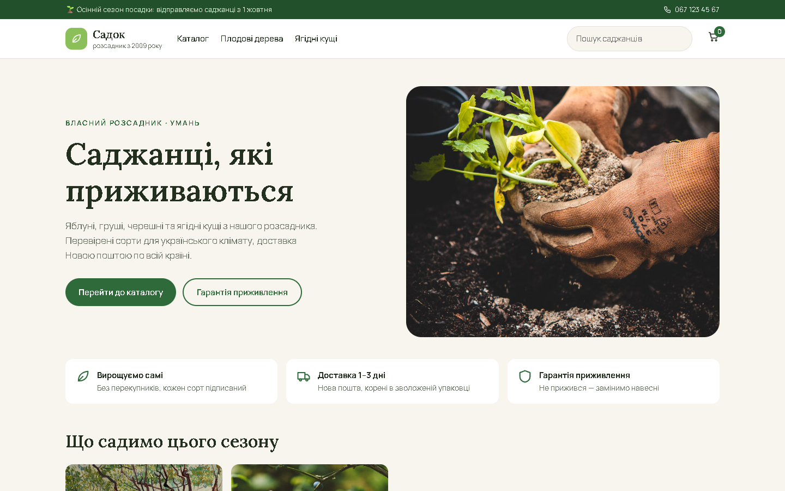
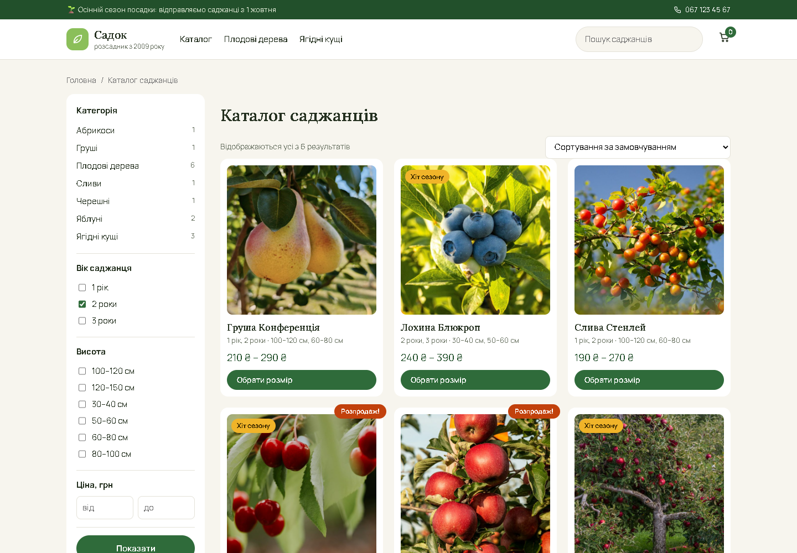
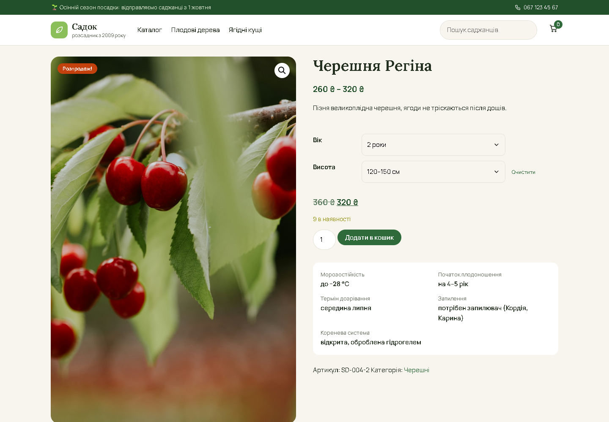

# Садок — інтернет-магазин саджанців на WordPress / WooCommerce

Власна легка тема без конструкторів сторінок і плагін з інструментами для українського магазину: імпорт з Excel, фід для Prom.ua, оплата LiqPay, відділення Нової пошти.

| Каталог з фільтрами | Сторінка товару з варіаціями |
| --- | --- |
|  |  |

## Тема `sadok`

- Класична PHP-тема на хуках WooCommerce — жодного Elementor/WPBakery, тому сторінки легкі: не підключаються блокові стилі WP, емодзі-скрипт, частина CSS WooCommerce
- **Каталог з фільтрами:** категорії, вік саджанця, висота, ціна (використовує вбудовану фільтрацію WooCommerce `filter_*`, `min_price`/`max_price`)
- **Варіації:** вік і висота як атрибути, на картці — короткий підпис «1 рік, 2 роки · 60–80 см»
- **Характеристики саджанця** (морозостійкість, плодоношення, дозрівання, запилення, коренева система) — поля в стандартній картці товару, на сайті показуються таблицею
- Бейджі «Хіт сезону» (рекомендовані товари) і «Розпродаж!», AJAX-лічильник кошика
- **SEO:** Schema.org `Store` на головній, meta description для товарів і категорій, хлібні крихти; розмітку `Product` генерує WooCommerce
- Адаптивна верстка, мобільне меню

## Плагін `sadok-tools`

- **Імпорт з Excel** (Товари → Імпорт з Excel): власний читач `.xlsx` без бібліотек; рядки з однаковою назвою стають варіаціями; вкладені категорії; фото за посиланням; повторний імпорт оновлює ціни й залишки за артикулом. Slug-и атрибутів і категорій транслітеруються латиницею — з кириличними фільтри WooCommerce не працюють
- **Фід для Prom.ua** у форматі YML за адресою `/prom-feed.xml`, з кешем і скиданням після зміни товару; варіації — окремі пропозиції з `group_id`
- **LiqPay** — платіжний шлюз WooCommerce: перехід на LiqPay Checkout, callback з перевіркою підпису, тестовий режим
- **Нова пошта** — спрощені поля оформлення, список відділень обраного міста з API НП (з кешем на добу)

## Встановлення

1. Скопіювати `wp-content/themes/sadok` і `wp-content/plugins/sadok-tools` у свій WordPress.
2. Встановити WooCommerce, активувати тему «Садок» і плагін «Садок — інструменти магазину».
3. Налаштування → Постійні посилання → «Назва запису» (потрібно для `/prom-feed.xml`).
4. Ключі LiqPay — у платежах WooCommerce, ключ Нової пошти — WooCommerce → Садок: налаштування.
5. Товари → Імпорт з Excel → `scripts/demo-products.xlsx`, щоб одразу заповнити каталог.

Інструкція для власника — [`docs/INSTRUKTSIYA.md`](docs/INSTRUKTSIYA.md).

## Стек

WordPress 7, WooCommerce 11, PHP 8.1+, MySQL / SQLite, JavaScript.

Скріншоти зроблені на локальному WordPress з демо-товарами з `scripts/demo-products.xlsx`. Фото — Unsplash.
